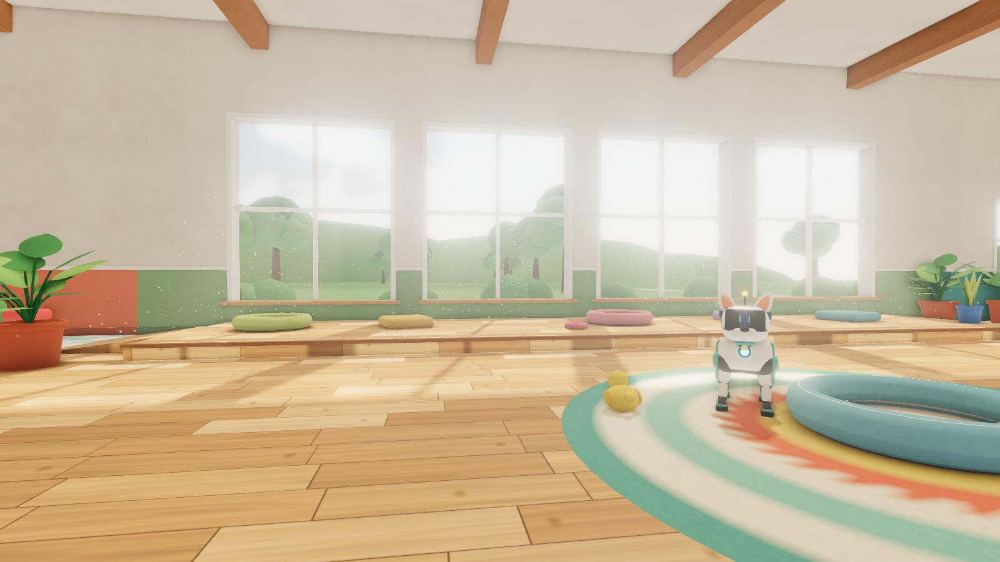

# RoboPup: Shelter Day

A playable 3D robotic-dog simulator with a third-person MMORPG camera, set in a
large, sunlit indoor dog shelter. Built with **Three.js** (r186), **Rapier**
physics and vanilla ES modules, with no frameworks.



- **Live demo:** https://robo-pup.vercel.app/
- **Technical write-up:** [TECHNICAL.md](TECHNICAL.md)
- **Credits & licenses:** [CREDITS.md](CREDITS.md)

## Features

- **"Bolt" the robo-pup.** An original, procedurally modelled quadruped with
  articulated legs, head, jaw, ears, antenna, a three-segment tail and an LED
  face.
- **Emotes** (hold Q / gamepad Y for the wheel, or press 1–7): Sit, Beg, Tail
  Wag, Zoomies (a sprint in circles), Roll Over, Play Bow and Sleep. Each is a
  procedural pose layer blended into the locomotion animation; moving or
  jumping cancels it smoothly. The pup also lies down to sleep by itself
  after a long idle.
- **Expressive LED face.** Six signed-distance-field expressions that morph
  into each other: neutral, happy, curious, sleepy (with floating "z"s),
  excited (star eyes) and low battery (amber, flickering, battery icon),
  plus blinking, squinting on hard landings and an open mouth for barks.
  Driven by gameplay: idling makes it sleepy, a new zone or a toy right in
  front makes it curious, a big toy hit nearby or Zoomies excites it.
- **Photo mode** (P / gamepad View / camera button). Freezes the game and
  detaches a free-fly camera that collides with the shelter and stays
  inside it. Controls: field of view, roll, depth of field (focus distance,
  aperture, focus on the pup), exposure, five filters with strength, show or
  hide the pup, pick its expression, hide the UI. Capture saves a PNG with an
  optional small watermark.
- **Saves.** One versioned save document (settings + progress) with
  migrations, lifetime stats in Settings › Progress, and "Reset progress".
- **F3 performance overlay.** FPS, frame time (average and worst), CPU time
  for game logic and draw submission, GPU time (where the browser exposes
  timer queries), draw calls, triangles, awake/total physics bodies, GPU
  memory, preset/resolution and the GPU name.
- **Procedural locomotion.**
  - Walk, trot and gallop gait cycle synced to ground speed.
  - World-planted feet with IK placement on ramps, stairs and soft-play domes.
  - Body tilt to terrain, lean, idle sit, jump and landing poses.
  - Spring-driven ears and antenna; tail wag tied to speed and state.
- **Responsive controls.**
  - Camera-relative movement with acceleration curves; sprint.
  - Real-gravity jumps with coyote time (100 ms), jump buffering (120 ms) and
    variable height.
  - Slope handling and step-up for ledges and ramps.
  - Bark (E) with sound, head animation and a playful nudge for nearby toys.
- **Physics toys.** Balls, beach balls, plush bones and ducks, donut rings and
  squeaky cubes to push around, with positional impact sounds.
- **MMORPG camera.** Drag to orbit, wheel to zoom, smooth follow, and sphere-cast
  collision that never clips through walls or props.
- **A big shelter** (40 × 30 m) with five zones:
  - Reception
  - Kennel rows (11 kennels with dog houses and beds)
  - Play zone (A-frame, ramps, play deck with stairs, tunnels, hurdles, weave
    poles, foam steps)
  - Feeding corner
  - Sunny nook with god-ray light shafts and dust motes
- **Rendering.**
  - PBR materials and stylised lighting.
  - Baked, ray-traced lightmap and AO (sun patches with window mullions, lamp
    pools).
  - Dynamic soft shadows for the dog and toys.
  - Baked reflection probe and GTAO.
  - Subtle bloom, ACES Filmic tone mapping and SMAA.
  - Low / Medium / High / Ultra presets, with Auto detection and frame-rate
    adaptation.
- **Audio.** Footsteps synced to the gait, jump, landing, bark, toy squeaks,
  ventilation hum, a water dispenser, distant dogs and room tone. Everything is
  synthesised in the browser and starts only after the first click.
- **Input.** Keyboard and mouse, gamepad (Gamepad API) and touch (virtual
  joystick, drag-to-orbit, Jump, Bark, Emote, Photo and Pause buttons). Every
  menu and panel can be driven with a gamepad (D-pad / left stick to move,
  A to select, left/right to adjust sliders, B to go back).
- **UI.**
  - Branded loading screen with real progress.
  - Start menu, pause menu (Esc), Settings and Controls panels.
  - HUD hints that fade out, the emote wheel, the photo-mode panel and the
    F3 performance overlay.
  - Responsive layout, plus a fallback message when WebGL 2 is unavailable.

## Quick start

Requires **Node.js 20.19+** (22 LTS recommended).

```bash
npm ci
npm run dev          # http://localhost:5173
```

Production build and local preview:

```bash
npm run build
npm run preview      # http://localhost:4173
```

## Scripts

| Command                                                    | What it does                                                                                                                                                                                                          |
| ---------------------------------------------------------- | --------------------------------------------------------------------------------------------------------------------------------------------------------------------------------------------------------------------- |
| `npm run dev`                                              | Vite dev server with HMR                                                                                                                                                                                              |
| `npm run build`                                            | Production build into `dist/` (code-split, content-hashed)                                                                                                                                                            |
| `npm run preview`                                          | Serve `dist/` on port 4173                                                                                                                                                                                            |
| `npm run lint` / `npm run format` / `npm run format:check` | ESLint 10 (flat config) and Prettier                                                                                                                                                                                  |
| `npm run assets`                                           | Regenerate every asset in `public/assets` (models, KTX2 textures, lightmap bake) and the hash manifest. Takes about 2 min, mostly the bake. Use `--only=textures,bake,models` and `--preview=<dir>` for PNG previews. |
| `npm run capture:backdrop -- --url=…`                      | Re-render the start-menu backdrop from the running game                                                                                                                                                               |
| `npm run test:smoke -- --url=…`                            | Headless browser quality gate (details under [Testing](#testing))                                                                                                                                                     |
| `node scripts/device-test.mjs --url=…`                     | Touch-emulation and gamepad tests                                                                                                                                                                                     |

The generated assets are committed, so `npm run assets` is only needed after
changing the layout, generators or bake settings.

## Controls

| Action                 | Keyboard & mouse                                         | Gamepad                        | Touch                              |
| ---------------------- | -------------------------------------------------------- | ------------------------------ | ---------------------------------- |
| Move                   | W A S D / arrows (camera-relative)                       | Left stick                     | Joystick (left half of the screen) |
| Sprint                 | Shift                                                    | RT (or LB)                     | Push the joystick to its edge      |
| Jump (hold for higher) | Space                                                    | A                              | ⤒ button                           |
| Bark                   | E                                                        | X or B                         | 🐾 button                          |
| Emote wheel            | Hold Q, point with the mouse, release (tap Q: stay open) | Hold Y, point a stick, release | ☺ button, then tap an emote        |
| Emotes directly        | 1–7                                                      | —                              | —                                  |
| Photo mode             | P                                                        | View / Back                    | 📷 button                          |
| Orbit camera           | Drag (left or right button)                              | Right stick                    | Drag on the right half             |
| Zoom                   | Mouse wheel                                              | RB / LT, D-pad                 | —                                  |
| Recenter camera        | —                                                        | R3                             | —                                  |
| Pause                  | Esc                                                      | Start                          | ‖ button                           |
| Menus                  | Mouse, Tab / Enter                                       | D-pad or left stick, A, B      | Tap                                |
| Performance overlay    | F3                                                       | —                              | —                                  |

Photo mode:

| Action           | Keyboard & mouse        | Gamepad               | Touch                   |
| ---------------- | ----------------------- | --------------------- | ----------------------- |
| Fly              | W A S D (Shift: faster) | Left stick            | Joystick                |
| Up / down        | E or Space / Q          | RT / LT               | ▲ / ▼ buttons           |
| Look             | Drag                    | Right stick           | Drag on the right half  |
| Field of view    | Mouse wheel             | RB / LB               | Panel slider            |
| Focus on the pup | F                       | R3                    | "Focus on pup" button   |
| Capture PNG      | C                       | X                     | Capture button          |
| Hide / show UI   | H (or click the view)   | Y                     | Hide UI, tap to restore |
| Panel controls   | Mouse                   | D-pad + A, left/right | Tap                     |
| Exit             | Esc or P                | B, View or Start      | ✕ on the panel          |

Settings (saved):

- graphics preset (Auto, Low, Medium, High, Ultra)
- field of view
- performance overlay
- camera sensitivity
- invert Y
- hide cursor while orbiting (pointer lock)
- master, effects and ambience volume
- photo watermark (set from the photo panel)

Settings › Progress lists lifetime stats (play time, distance, jumps, barks,
emotes, photos). **Reset progress** asks for a second press to confirm, then
erases progress while keeping settings.

### Save data

Everything persistent lives in one localStorage document, `robopup.save`:

```json
{ "version": 1, "savedAt": 1760000000000, "settings": { … }, "progress": { "stats": { … } } }
```

`SaveManager` loads it (or the older settings-only `robopup.settings.v1` key),
runs every migration up to the current `version` (`MIGRATIONS[n]` upgrades
version n to n + 1), validates the result against the default shapes, and
writes the upgraded document back. Writes are coalesced (at most one every
2 s) and flushed when pausing or leaving the page. Without storage (private
mode, blocked cookies) the game keeps everything in memory and Settings says
so. Later phases add their own `progress` sections and a migration when a
shape changes.

## Architecture

```
src/
  main.js           entry: loading screen → asset download → start menu → boots the engine on Play
  config/           config.js (every tuning value) · assetManifest.js (generated hashes)
  core/             Engine (composition root, state machine) · Loop (fixed 60 Hz + interpolation)
                    Time · Input (keyboard/mouse/gamepad/touch, play/photo/menu modes) · EventBus
                    SaveManager (versioned save, migrations) · SettingsStore · StatsTracker
                    Preloader (fetch with byte progress) · AssetLoader (LoadingManager, glTF, KTX2)
  physics/          PhysicsWorld (Rapier, queries) · CharacterController (kinematic capsule)
  player/           RobotDog (model + bones) · DogAnimator (gait, IK, secondary motion, emote layer)
                    DogController (input → movement, jump rules, bark) · LegIK · robotDogGeometry (generator)
                    EmoteSystem (start/cancel/steer emotes) · emotePoses (pose definitions)
                    FaceController (expression priorities, blinking)
  camera/           ThirdPersonCamera (orbit, zoom, collision) · PhotoMode · PhotoCamera (free fly)
  world/            Shelter (assembly, lights, probe) · layout (single source of truth)
                    colliderSpecs · propCatalog · Architecture · PropInstancer (instancing + LOD)
                    Toys · LightShafts · Outdoor · Signage · MaterialLibrary · props/* (generators)
  render/           Renderer · PostFX · QualityManager · ShelterGTAOPass · PhotoPasses (DOF, grading)
                    GpuTimer · gpuSync · shaders/*
  audio/            AudioManager (buses, pools, emitters) · SoundSynth (procedural sounds)
  ui/               LoadingScreen · Menu · SettingsPanel · ControlsPanel · HUD · TouchControls
                    EmoteWheel · PhotoPanel · DebugOverlay (F3) · GamepadNav (menu navigation)
scripts/            build-assets.mjs + assetgen/* (offline pipeline) · smoke/device tests · backdrop capture
public/assets/      models/*.glb (Meshopt) · textures/*.ktx2 (Basis)
```

How it fits together:

- **Communication.** Modules talk through the `EventBus` (for example
  `player:footstep`, `player:bark`, `toy:impact`, `emote:request`,
  `emote:start`, `photo:captured`, `save:progress-reset`, `settings:changed`)
  and through explicit constructor dependencies. There are no globals.
- **States.** The engine moves between menu, playing, paused and photo. Photo
  mode stops the fixed simulation and the world's animation clock; only the
  free camera and camera-dependent work (LOD, shadows) keep running.
- **Fixed timestep.** `Loop` runs physics at exactly 60 Hz; rendering
  interpolates the dog and toys with the leftover fraction.
- **One layout.** `world/layout.js` drives the visuals, the Rapier colliders
  and the offline lightmap bake, so they cannot drift apart.
- **Lazy boot.** The engine chunk (three.js, Rapier, game code) loads only
  when the player presses Play; the first page view stays light.
  [TECHNICAL.md](TECHNICAL.md) explains why.

## Performance

Measured on an i7-1165G7 laptop with **Intel Iris Xe** integrated graphics
(on AC power), 1280×720, Edge 155, at the heaviest viewpoint (the sunlit nook
with light shafts, looking across the shelter). Both runs render on the real
GPU (`ANGLE … Iris Xe … Direct3D11`); "headed" is a normal visible window.
Background CPU load was 30–45% (VS Code).

| Preset | Headless FPS | Headed FPS | GPU ms/frame | Draw calls | Triangles |
| ------ | ------------ | ---------- | ------------ | ---------- | --------- |
| Low    | 60 (vsync)   | 60 (vsync) | 8            | 112        | 509k      |
| Medium | 50           | 49         | 19           | 133        | 513k      |
| High   | 36           | 33         | 27           | 137        | 515k      |
| Ultra  | 20           | 20         | 46–49        | 141        | 519k      |

- At lighter viewpoints (reception, kennels) Medium runs at 58–60 FPS.
- Game logic (physics, controller, animation, emotes, face, camera) costs
  1.8–4 ms of CPU per frame. Every preset above Low is GPU-bound.
- The **Auto** preset steps down when the measured frame rate stays under
  55 FPS (desktop) or 28 FPS (mobile), and at Low it lowers the render scale.
- Photo mode with full depth of field (High, f/1.4) runs at about 24–27 FPS.
  The simulation is frozen, so only framing speed is affected. Outside photo
  mode its passes are disabled and cost nothing.
- Press **F3** in game to see the same numbers on your own machine: FPS,
  average and worst frame time, CPU logic and draw time, GPU time (Chromium),
  draw calls, triangles, physics bodies, GPU memory, preset and resolution,
  and the GPU name. A software rasteriser is flagged in red.
  [TECHNICAL.md §7](TECHNICAL.md) explains how each value is measured.

Budget targets: Medium at 60 FPS on integrated GPUs (met at most viewpoints,
about 50 at the heaviest one on Iris Xe); under 300 draw calls at High.

- Initial download is about 4.2 MB transferred (gzip) for code plus data,
  with 1.6 MB of that being Rapier's inlined WASM. The budget was under
  15 MB. The entry chunk (menus, input, saves) is 17 KB gzip and the engine
  chunk 61 KB gzip.
- Lighthouse 13.5 desktop (local production build, plain static server):
  - Performance 100, Accessibility 100, Best Practices 100, SEO 100.
  - FCP 0.4 s, LCP 0.4 s, TBT 0 ms, CLS 0.
- GPU memory returns to baseline after cycling every preset and after
  entering and leaving photo mode. It stays flat across soak tests.

## Testing

```bash
npm run build && npm run preview &
npm run test:smoke -- --url=http://localhost:4173/                  # Edge/Chrome
npm run test:smoke -- --url=http://localhost:4173/ --soak=600       # 10-minute soak
node scripts/device-test.mjs --url=http://localhost:4173/           # touch + gamepad
npm run test:smoke -- --url=http://localhost:4173/ --software       # GPU-less CI conditions (SwiftShader)
npx playwright-core install firefox webkit                          # once
npm run test:smoke -- --url=http://localhost:4173/ --browser=firefox
npm run test:smoke -- --url=http://localhost:4173/ --browser=webkit
```

Both tests wait on the game's own clocks (rendered frames, 60 Hz physics
steps, emote time) rather than fixed sleeps. They therefore pass on a GPU at
60 FPS and on GPU-less CI runners, where Chrome falls back to SwiftShader and
renders a frame every few seconds. On a software renderer the tests shrink
the viewport to 640×360 and switch off the photo-mode depth-of-field pass.
`--software` forces SwiftShader locally to reproduce CI.

The smoke test fails on any console error or warning, page error or failed
request. It checks:

- the save migration (a legacy settings key becomes the versioned save);
- loading, the start menu and booting into the game;
- movement, sprint, jump, bark, orbit and zoom;
- grounding and staying above the floor;
- Esc pause and resume;
- the F3 overlay;
- emotes: a number key starts one, movement cancels it, the Q wheel picks
  one with the mouse, Zoomies runs, Roll Over rolls onto its back, Sleep shows
  the sleepy face;
- photo mode: the simulation freezes, the camera flies, the wheel changes the
  FOV, a filter applies, C saves a PNG, and Esc restores the camera;
- stats surviving a reload, and Settings › Reset progress;
- frame rate per preset;
- GPU memory before and after cycling every preset (and, with `--soak`, JS
  heap and frame-rate stability).

The device test drives, with real touch events and an injected gamepad: the
joystick, orbit, Jump/Bark/Pause, the emote button and wheel, the photo
button, the rise button and the panel's close button; on the gamepad, the
stick, A, Start, D-pad + A menu navigation into photo mode, RT, X capture,
B exit, and the Y emote wheel.

Verified locally (Phase A build):

- **Chrome 155 / Edge 155:** smoke test passes.
  - A 5-minute soak (random movement, sprints, jumps and barks at Medium)
    held 48.7 → 49.1 FPS. The JS heap went from 52 to 34 MB, GPU geometry
    and texture counts stayed constant, and the dog never went below the
    floor.
  - The earlier 10-minute soak of the core build behaved the same way.
- **Firefox:** Playwright Firefox 157 build passes.
- **WebKit:** Playwright WebKit 27.2 build passes. This build has no Web
  Audio, so the game runs silently there.
- **Touch and gamepad:** device tests pass in Edge and Chrome.

A locally installed VS Code extension (Console Ninja) injects a script into
pages served by `vite preview` and the dev server. It never touches `dist/`.
For clean local measurements, serve `dist/` with any plain static file
server.

Real Safari on macOS/iOS and physical phones were not available for testing.

## Deployment

Live at **https://robo-pup.vercel.app/**, hosted on **Vercel**. The build is
static (`dist/`). `vercel.json` sets:

- `npm ci` + `npm run build`, output `dist/`;
- a correct `application/wasm` MIME type for `.wasm` files;
- immutable caching for the content-hashed `/bundle/*` files and the
  `?v=<hash>` `/assets/*` files, and revalidation for `index.html`;
- basic security headers.

`.vercelignore` keeps `dist/` and `node_modules/` out of CLI uploads.

**How updates go live.** The Vercel project is connected to the GitHub
repository. Every push to `main` is built and deployed to production by
Vercel itself, and every pull request gets a preview URL. No tokens or
secrets are stored in GitHub.

**CI.** `.github/workflows/ci.yml` runs on every push and pull request to
`main`: install → lint → format check → build → smoke and device tests
(headless Chrome on the production build). GitHub's runners have no GPU, so
Chrome renders with SwiftShader there (see [Testing](#testing)). Vercel
deploys independently of CI. To hold production back until CI passes, enable
Vercel's deployment checks for the "CI" workflow in the Vercel project
settings.

**Manual deploy** (not normally needed):

```bash
npx vercel@63.1.2 login     # once; opens the browser
npx vercel@63.1.2 --prod    # production deployment from this machine
```

## Project conventions

- Every gameplay, camera, physics, rendering and audio tuning value lives in
  `src/config/config.js`.
- Public classes and methods carry JSDoc. ESLint (flat config) and Prettier
  run in CI.
- No frameworks: three.js, Rapier and vanilla JavaScript only. Vite is used
  only for development and bundling.

## License

Code: MIT ([LICENSE](LICENSE)). Generated assets (models, textures, baked
lighting, synthesised audio): CC0 1.0. Third-party libraries keep their own
licenses; see [CREDITS.md](CREDITS.md).
